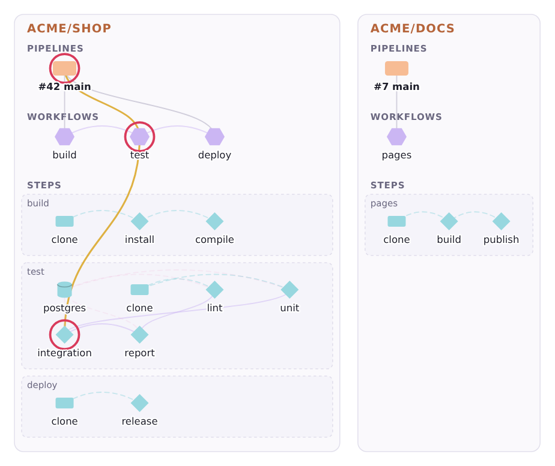

# stratoscope-ci

Shows CI pipelines from [Woodpecker](https://woodpecker-ci.org) and [Drone](https://www.drone.io)
as a layered graph: pipelines on top, workflows (Drone: stages) below them, steps at the bottom,
with the `depends_on` links between workflows and between steps. Click a failed step to see what
it blocked, or a red pipeline to see why it failed.

> Experimental. Formerly `infra3d-import-ci`. Tried against a real Drone server; Woodpecker is
> covered by tests only so far.



## CLI

The connection comes from the same variables the CI's own CLI uses. The token is a personal
access token from your user profile in the CI's web UI.

```sh
export DRONE_SERVER=https://drone.example.com DRONE_TOKEN=...            # Drone
export WOODPECKER_SERVER=https://ci.example.com WOODPECKER_TOKEN=...     # or Woodpecker

npx stratoscope-ci -f svg -o pipelines.svg              # every active repository
npx stratoscope-ci -r acme/shop -n 3 -f drawio -o shop.drawio
npx stratoscope-ci -f snapshot -o snapshot.json         # the fetched runs, to replay later
npx stratoscope-ci --from snapshot.json -f json -o topology.json
```

| Option | |
| --- | --- |
| `-s, --source` | `woodpecker` or `drone` (default: whichever variables are set) |
| `-r, --repo <owner/name>` | repository to read; repeat for more (default: all active ones) |
| `-n, --pipelines <n>` | latest pipelines per repository (default 1) |
| `-b, --branch <name>` | only this branch, `*` for any (default: the repository's default branch) |
| `-f, --format` | `json` (topology), `svg`, `drawio` or `snapshot` |
| `--view` | `columns` (one card per repository, default) or `layers`, for SVG |
| `--dark` | dark colours, for SVG |
| `--from <file>` | build from a snapshot instead of the API |
| `--config <owner/name>=<file>` | pipeline config of a repository, e.g. from a local checkout; repeat for more (see [Results](#results)) |
| `--skip-config` | do not read the config from the Woodpecker API |
| `--outputs <file>` | rules for results the config does not show |
| `--results latest` | results from the latest run that built them, not only from the fetched pipelines (see [below](#the-latest-build-of-every-result)) |
| `--results-branch <b>`, `--results-event <e>`, `--results-depth <n>` | which older runs count for `--results latest`, and how many to load at most |

The JSON topology carries the CI profile and each node's status, so `<Scene>`,
`<Diagram>`, `toSvg` and `toDrawio` from [stratoscope](https://github.com/SurfaceScratcher/stratoscope/tree/main/packages/stratoscope) show it without further options.

Keep the token in the environment, not on the command line. The output contains repository
names, branches, commit messages and authors, so treat it like the CI itself.

## The graph

| Layer | Woodpecker | Drone | Column / group |
| --- | --- | --- | --- |
| Pipelines | pipeline | build | repository |
| Workflows | workflow (one per config file) | stage (one per `kind: pipeline`) | repository |
| Steps | step, service | step, detached step (service) | repository, grouped by workflow |

| Edge | From → to |
| --- | --- |
| `contains` | pipeline → workflow |
| `runs` | workflow → step (implied by the workflow box in the columns view) |
| `needs` | workflow → workflow and step → step, from `depends_on` |
| `after` | step → previous step, for workflows without `depends_on` (they run in order); with `depends_on`, steps without it start after the clone |
| `uses` | step → service of the same workflow |

| `builds` | result → step that builds it (image, package, release) |
| `deploys` | deploy target → step that delivers to it |

States become node status: `success` is ok; `failure`, `error` and `killed` are down; everything
else (running, pending, skipped, blocked, …) is unknown. Each node keeps its state, duration,
exit code and a link to the CI's web UI in `meta`.

## Results

Steps can show what they produce and where it goes: container **images**, **packages**,
**releases** and **deploy targets**. They sit on a fourth layer, *Results*, above the pipelines,
and only appear when some step has one. A result has the status of the latest run of the step
that produces it, so the impact view of a failed step shows which images and targets are now
outdated. An image that several pipelines or repositories build is one node.

The API only reports state, so results come from the pipeline config:

- **Woodpecker** serves the config of each run; the connector reads it unless `--skip-config`.
- **Drone** has no such endpoint: pass the `.drone.yml`, e.g. from a local checkout, with
  `--config acme/shop=../shop/.drone.yml`.

| Found in | Becomes |
| --- | --- |
| Docker plugins (`plugins/docker`, `…/docker-buildx`, `kaniko`, `buildah`, …): `repo`, `registry`, `tags` | image, without tag; the tags in `meta` |
| `scp`, `rsync`, `sftp` plugins: `host`, `target` | deploy target `host:path` |
| `ssh` plugins: `host`, and a script that starts with `cd /path` | deploy target `host:path`, so copy and restart meet in one node |
| `npm` and release plugins | package, release |
| commands: `docker push`, `docker buildx build --push -t`, `npm publish`, `scp`/`rsync` to `host:/path` | image, package, deploy target |

Other shell commands are not guessed at. A host that comes from a secret shows as
`<secret-name>`; the rules can name it. Rules also add results for steps the config does not
explain, or hide them with `[]`:

```json
{
  "secrets": { "deploy-ssh-host": "prod" },
  "steps": {
    "acme/shop": { "deploy/upload": [{ "kind": "deploy", "target": "prod:/srv/shop" }], "notify": [] }
  }
}
```

Put host names in `secrets`, never the secret values themselves. In code:
`attachOutputs(repo, pipeline, configFiles, rules)` fills a pipeline's steps, `detectOutputs(step)`
reads one step's config, and `fetchSnapshot` takes `configFiles`, `outputRules` and `readConfig`.

### The latest build of every result

By default results come from the fetched pipelines (`-n`, `-b`). In a repository with many
feature-branch runs, the builds and deploys that matter run rarely, so an image may be missing or
show an old state. `--results latest` fills the result layer from the latest run whose producing
step finished, however far back:

```bash
stratoscope-ci -r acme/shop -n 5 --results latest --results-branch default --results-event tag
```

- Every result the config of the fetched pipelines can produce is looked for; the CLI pages back
  through older runs until each is found, at most `--results-depth` runs (default 100).
- `--results-branch` (`default` = the default branch) and `--results-event` limit which runs count;
  a run on a listed branch or of a listed event is enough. Without them every run counts.
- The pipelines, workflows and steps stay the fetched ones. A result carries `Pipeline` and `Link`
  of the run its state comes from; the snapshot keeps those runs in `producers`, cut down to the
  producing steps.

In code: `fetchSnapshot({ results: 'latest', resultsBranches, resultsEvents, resultsDepth })`.

## With the infrastructure

The images a pipeline builds are the ones containers run, and its deploy targets are the
directories where stacks live. `combineWithInfra` puts a CI topology and a
[stratoscope-infra](https://github.com/SurfaceScratcher/stratoscope-infra) topology into one and
links them:

```ts
import { combineWithInfra } from 'stratoscope-ci';
import { INFRA_PROFILE } from 'stratoscope-infra/core';

const both = combineWithInfra(ciTopology, infraTopology, { fallback: INFRA_PROFILE });
```

| Edge | From → to | Matched by |
| --- | --- | --- |
| `runs-image` | container → image | `meta.Image` without tag, so `app:${TAG:-latest}` matches `app` |
| `deployed-by` | container → deploy target | the target path ends in the container's stack (`group`) and names its host (`column`), as host (`prod:/srv/shop`) or directory (`…/hosts/prod/shop`) |

The CI layers sit at the bottom, with the results right below the hosts. Each column keeps its own
anchor: repositories are anchored on their steps, hosts on their containers. Both link kinds pass
no failure on. Click a failed step to see which running containers are now outdated; their
endpoints are not marked as affected. `linkToInfra(ci, infra)` returns just the edges.

If the CI pushes to a registry under another name than the one the hosts pull from (`localhost:5000`
on the build host, `registry.example.internal:5000` on the network), say they are the same:

```ts
combineWithInfra(ciTopology, infraTopology, {
  fallback: INFRA_PROFILE,
  registryAliases: { 'localhost:5000': 'registry.example.internal:5000' },
});
```

The aliases only affect matching; the image nodes keep their names.

## API

Each source translates its API into one neutral model (`CiSnapshot`); the graph is built from
that alone, so another CI only needs another source.

```ts
import { drone, buildTopology } from 'stratoscope-ci';
import { Diagram } from 'stratoscope';

const snapshot = await drone.fetchSnapshot({ server, token, repos: ['acme/shop'], pipelines: 3 });
const topology = buildTopology(snapshot);

// The topology carries CI_PROFILE and each node its status, so nothing else is needed
<Diagram topology={topology} view="columns" />
```

`fromWoodpecker` and `fromDrone` translate single API responses, e.g. from a webhook.

## License

MIT
